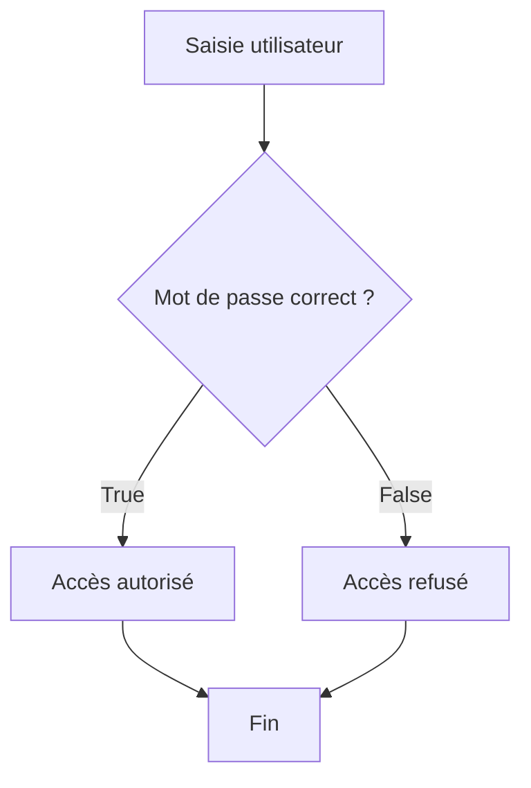

# Python — Le guide essentiel du programmeur

> Cours de référence et pense-bête pour débuter en programmation.

Ce cours a vocation à servir de **support de référence tout au long de l'apprentissage de Python**. L'objectif est de pouvoir y revenir lorsqu'une instruction, une syntaxe ou une notion a été oubliée. Les exemples utilisent Python 3.

## Sommaire

1. [Les bases de Python](#1-les-bases-de-python)
2. [Les variables et les types de données](#2-les-variables-et-les-types-de-données)
3. [Les chaînes de caractères](#3-les-chaînes-de-caractères)
4. [Les tests et les conditions](#4-les-tests-et-les-conditions)

---

## 1. Les bases de Python

### 1.1. Créer et exécuter un programme

Un programme Python est généralement enregistré dans un fichier portant l'extension `.py`, par exemple `programme.py`.

Depuis un terminal Linux :

```bash
python3 programme.py
```

Sous Windows, selon l'installation :

```powershell
python programme.py
```

Pour connaître la version de Python installée :

```bash
python3 --version
```

#### Depuis Visual Studio Code (VS Code)

VS Code est un éditeur de code qui permet d'écrire, d'exécuter et de déboguer des programmes Python depuis une même interface.

**Préparer l'environnement (à effectuer une seule fois) :**

1. Installer Python 3 sur son ordinateur, puis Visual Studio Code.
2. Ouvrir VS Code et accéder à l'onglet **Extensions** (`Ctrl + Shift + X` sous Windows/Linux, `Cmd + Shift + X` sous macOS).
3. Rechercher et installer l'extension **Python**, publiée par Microsoft (`ms-python.python`). L'extension ne remplace pas l'installation de Python.
4. Ouvrir la palette de commandes (`Ctrl + Shift + P` sous Windows/Linux, `Cmd + Shift + P` sous macOS), rechercher `Python: Select Interpreter` et sélectionner l'interpréteur Python 3 à utiliser.

**Créer son premier programme :**

1. Dans VS Code, ouvrir un dossier de travail via **Fichier > Ouvrir un dossier** (*File > Open Folder*).
2. Dans l'explorateur, créer un fichier nommé `programme.py`.
3. Saisir les instructions suivantes :

```python
print("Bonjour tout le monde !")
```

4. Enregistrer le fichier (`Ctrl + S` ou `Cmd + S` sur macOS).
5. Cliquer sur le bouton triangulaire **Run Python File** situé en haut à droite de l'éditeur (ou effectuer un clic droit dans le fichier et choisir **Run Python File in Terminal**).
6. Observer le résultat dans le terminal intégré :

```text
Bonjour tout le monde !
```

**Exécuter le programme manuellement depuis le terminal intégré :**

Ouvrir **Terminal > Nouveau terminal** (*Terminal > New Terminal*). Vérifier que le terminal se situe dans le dossier contenant le fichier, puis utiliser la commande adaptée :

| Système | Commande |
| --- | --- |
| Linux / macOS | `python3 programme.py` |
| Windows | `python programme.py` ou `py programme.py` |

Pour les programmes utilisant `input()`, saisir les informations directement dans l'onglet **Terminal**, et non dans un panneau de sortie en lecture seule.

**Quelques raccourcis utiles :**

| Action | Windows / Linux | macOS |
| --- | --- | --- |
| Enregistrer | `Ctrl + S` | `Cmd + S` |
| Palette de commandes | `Ctrl + Shift + P` | `Cmd + Shift + P` |
| Rechercher dans le fichier | `Ctrl + F` | `Cmd + F` |
| Commenter / décommenter une ligne | `Ctrl + /` | `Cmd + /` |
| Démarrer le débogage | `F5` | `F5` |
| Interrompre un script dans le terminal | `Ctrl + C` | `Ctrl + C` |

Les raccourcis peuvent varier selon le clavier et les réglages de VS Code.

> **En cas de problème :** vérifier que Python est installé, que le bon interpréteur est sélectionné et que le fichier possède bien l'extension `.py`. Si une commande n'est pas reconnue dans le terminal, vérifier également la configuration du PATH ou utiliser le bouton d'exécution de VS Code.

### 1.2. Afficher une information

La fonction `print()` permet d'afficher une information dans la console.

```python
print("Bonjour tout le monde")
print(42)
print(10 + 5)
```

Résultat :

```text
Bonjour tout le monde
42
15
```

Il est possible d'afficher plusieurs informations dans une même instruction.

```python
prenom = "Aziz"
age = 20

print("Bonjour", prenom, "vous avez", age, "ans.")
```

Une **f-string** permet d'intégrer directement des variables dans une chaîne de caractères.

```python
print(f"Bonjour {prenom}, vous avez {age} ans.")
```

### 1.3. Les commentaires

Les commentaires permettent de documenter un programme, d'expliquer un raisonnement ou de faciliter la compréhension du code. Ils ne sont pas exécutés par Python.

```python
# Ceci est un commentaire
prix = 100  # Prix unitaire du produit

# Calcul du montant TTC
prix_ttc = prix * 1.20
```

Un bon commentaire explique pourquoi une instruction est utilisée, plutôt que de simplement répéter ce qu'elle fait.

### 1.4. L'indentation

En Python, l'indentation délimite les blocs d'instructions. Elle fait partie de la syntaxe du langage.

**Code correct :**

```python
age = 20

if age >= 18:
    print("Majeur")
    print("Autorisé")

print("Fin")
```

**Code incorrect :**

```python
age = 20

if age >= 18:
print("Majeur")
print("Autorisé")

print("Fin")
```

> Par convention, une indentation correspond à quatre espaces.

---

## 2. Les variables et les types de données

### 2.1. Qu'est-ce qu'une variable ?

Une variable est un nom permettant de désigner une valeur en mémoire. Cette valeur peut évoluer tout au long de l'exécution du programme. Pour comprendre simplement le principe, on peut imaginer une variable comme une boîte portant une étiquette.

```python
prenom = "Aziz"
age = 20
prix = 15.99
```

| Nom | Valeur | Type |
| --- | --- | --- |
| `prenom` | `"Aziz"` | `str` |
| `age` | `20` | `int` |
| `prix` | `15.99` | `float` |

L'instruction `age = 20` se lit de droite à gauche : la valeur 20 est affectée à la variable `age`. Python ne nécessite pas de déclarer explicitement le type d'une variable avant de l'utiliser.

### 2.2. Les règles de nommage

Il est important de choisir des noms explicites afin de faciliter la compréhension et la maintenance du programme.

| Nom déconseillé | Nom recommandé |
| --- | --- |
| `a` | `age_utilisateur` |
| `p` | `prix_unitaire` |
| `nb` | `nombre_articles` |
| `x` | `montant_total` |
| `mdp` | `mot_de_passe` |

Un nom de variable ne peut pas commencer par un chiffre, contenir d'espace ou correspondre à un mot-clé réservé de Python. Python est sensible à la casse : `prix`, `Prix` et `PRIX` désignent trois noms différents.

La convention de nommage est le **snake_case** : les mots sont écrits en minuscules et séparés par des underscores.

### 2.3. Les principaux types de données

| Type | Signification | Exemple |
| --- | --- | --- |
| `int` | Nombre entier | `25` |
| `float` | Nombre décimal | `15.75` |
| `str` | Chaîne de caractères | `"Bonjour"` |
| `bool` | Booléen | `True`, `False` |
| `list` | Liste | `[10, 15, 20]` |
| `tuple` | Séquence non modifiable | `(10, 15, 20)` |
| `dict` | Dictionnaire | `{"nom": "Aziz"}` |
| `set` | Ensemble sans doublons | `{1, 2, 3}` |
| `NoneType` | Absence de valeur | `None` |

La fonction `type()` permet de connaître le type d'une valeur.

```python
age = 20
prix = 15.99

print(type(age))
print(type(prix))
```

```text
<class 'int'>
<class 'float'>
```

### 2.4. Convertir une variable

| Instruction | Rôle | Résultat |
| --- | --- | --- |
| `int("25")` | Convertir en entier | `25` |
| `float("25.5")` | Convertir en décimal | `25.5` |
| `str(25)` | Convertir en texte | `"25"` |
| `bool(1)` | Convertir en booléen | `True` |
| `bool(0)` | Convertir en booléen | `False` |
| `int(15.9)` | Convertir en entier | `15` |
| `list("ABC")` | Convertir en liste | `["A", "B", "C"]` |

Attention, `int()` ne réalise pas un arrondi : il tronque vers zéro.

### 2.5. Récupérer une information saisie au clavier

```python
nom = input("Entrez votre nom : ")
print(f"Bonjour {nom}")
```

`input()` retourne toujours une chaîne de caractères, même lorsque l'utilisateur saisit un nombre. Une conversion est indispensable pour effectuer des calculs numériques.

```python
age = int(input("Entrez votre âge : "))
prix = float(input("Entrez un prix : "))
```

### 2.6. Les opérateurs arithmétiques

| Opérateur | Signification | Exemple | Résultat |
| --- | --- | --- | --- |
| `+` | Addition | `10 + 3` | `13` |
| `-` | Soustraction | `10 - 3` | `7` |
| `*` | Multiplication | `10 * 3` | `30` |
| `/` | Division | `10 / 4` | `2.5` |
| `//` | Division par plancher | `10 // 3` | `3` |
| `%` | Modulo (reste) | `10 % 3` | `1` |
| `**` | Puissance | `10 ** 2` | `100` |

Le modulo permet notamment de déterminer si un nombre est pair, impair ou divisible par un autre nombre.

```python
nombre = 12

print(nombre % 2)  # 0 : le nombre est pair
print(nombre % 5)  # 2 : reste de la division
```

### 2.7. Les opérateurs d'affectation

| Écriture simplifiée | Écriture équivalente |
| --- | --- |
| `x += 5` | `x = x + 5` |
| `x -= 5` | `x = x - 5` |
| `x *= 5` | `x = x * 5` |
| `x /= 5` | `x = x / 5` |
| `x //= 5` | `x = x // 5` |
| `x %= 5` | `x = x % 5` |
| `x **= 5` | `x = x ** 5` |

```python
solde = 1000
solde -= 200
solde += 50
print(solde)  # 850
```

### 2.8. Les fonctions mathématiques essentielles

| Fonction | Utilisation | Résultat |
| --- | --- | --- |
| `round(12.567, 2)` | Arrondir à deux décimales | `12.57` |
| `abs(-15)` | Valeur absolue | `15` |
| `pow(2, 3)` | Calculer une puissance | `8` |
| `min(5, 8, 2)` | Trouver le minimum | `2` |
| `max(5, 8, 2)` | Trouver le maximum | `8` |
| `sum([5, 8, 2])` | Calculer une somme | `15` |

Pour les arrondis à l'entier inférieur et supérieur, on peut utiliser le module standard `math`.

```python
import math

nombre = 12.567
print(math.floor(nombre))  # 12
print(math.ceil(nombre))   # 13
print(round(nombre, 2))    # 12.57
```

---

## 3. Les chaînes de caractères

Une chaîne de caractères (`str`) représente une succession de caractères : lettres, chiffres, espaces ou symboles.

```python
message = "Bonjour"
adresse_ip = "192.168.1.10"
mot_de_passe = "Test123"
```

### 3.1. La concaténation

La concaténation consiste à assembler plusieurs chaînes de caractères.

```python
prenom = "Aziz"
nom = "Dupont"

identite = prenom + " " + nom
print(identite)

identite = f"{prenom} {nom}"
```

> Les chaînes de caractères sont aussi des séquences. Leur manipulation par indices, le découpage (slicing) et leurs méthodes sont présentés au [chapitre 6](#6-les-tableaux-et-les-listes), avec les listes, afin de comparer leurs points communs et leurs différences.

### 3.2. Les caractères spéciaux

| Caractère | Signification |
| --- | --- |
| `\n` | Retour à la ligne |
| `\t` | Tabulation |
| `\\` | Antislash |
| `\"` | Guillemet double |
| `\'` | Apostrophe |

```python
print("Nom\tAge\nAziz\t20")
```

```text
Nom     Age
Aziz    20
```

### 3.3. Formater l'affichage des variables

Les f-strings permettent de contrôler la présentation des résultats.

```python
prix = 19.5678
print(f"Prix : {prix:.2f} €")
```

| Syntaxe | Exemple de résultat |
| --- | --- |
| `f"{prix:.2f}"` | `19.57` |
| `f"{prix:.1f}"` | `19.6` |
| `f"{7:03d}"` | `007` |
| `f"{0.25:.0%}"` | `25%` |
| `f"{'Python':>10}"` | Alignement à droite |
| `f"{'Python':<10}"` | Alignement à gauche |
| `f"{'Python':^10}"` | Alignement centré |

Ces éléments sont particulièrement utiles pour réaliser des menus, des factures ou des rapports dans un terminal.

---

## 4. Les tests et les conditions

Les conditions permettent de prendre des décisions en fonction des informations dont dispose le programme. Par exemple, déterminer si un utilisateur possède les droits nécessaires, si un serveur dépasse un seuil de température ou si un solde est suffisant.

### 4.1. Les opérateurs de comparaison

Une comparaison entre les valeurs simples étudiées ici retourne `True` ou `False`.

| Opérateur | Signification | Exemple | Résultat |
| --- | --- | --- | --- |
| `==` | Égal à | `5 == 5` | `True` |
| `!=` | Différent de | `5 != 5` | `False` |
| `>` | Strictement supérieur | `8 > 5` | `True` |
| `<` | Strictement inférieur | `8 < 5` | `False` |
| `>=` | Supérieur ou égal | `5 >= 5` | `True` |
| `<=` | Inférieur ou égal | `3 <= 5` | `True` |
| `in` | Appartient à | `"a" in "chat"` | `True` |
| `not in` | N'appartient pas à | `"z" not in "chat"` | `True` |

Il est possible de réaliser une comparaison sans utiliser de structure conditionnelle.

```python
age = 20
majeur = age >= 18
print(majeur)  # True
```

> **Attention :** `=` correspond à une affectation, tandis que `==` correspond à une comparaison.

### 4.2. La condition IF

```python
temperature = 85

if temperature > 80:
    print("Attention : surchauffe du serveur")

print("Fin de la vérification")
```

La dernière instruction est exécutée que la condition soit vraie ou fausse, car elle se situe en dehors du bloc `if`.

### 4.3. La condition IF / ELSE

`else` permet de définir les instructions à exécuter lorsque la condition est fausse.

```python
mot_de_passe = input("Mot de passe : ")

if mot_de_passe == "Test123":
    print("Accès autorisé")
else:
    print("Accès refusé")
```



Cet exemple illustre uniquement les conditions. Dans une véritable application, un mot de passe ne doit pas être stocké en clair dans le code source.

### 4.4. La condition IF / ELIF / ELSE

Lorsqu'il existe plusieurs situations possibles, on utilise `elif`.

```python
note = float(input("Entrez votre note : "))

if note < 0 or note > 20:
    print("Note invalide")
elif note >= 16:
    print("Très bien")
elif note >= 14:
    print("Bien")
elif note >= 12:
    print("Assez bien")
elif note >= 10:
    print("Admis")
else:
    print("Non admis")
```

Python analyse les conditions dans leur ordre d'apparition. Dès qu'une condition est vraie, le bloc correspondant est exécuté et les autres branches sont ignorées.

### 4.5. Les opérateurs logiques

| Opérateur | Signification | Fonctionnement |
| --- | --- | --- |
| `and` | ET | Les deux conditions doivent être vraies |
| `or` | OU | Au moins une condition doit être vraie |
| `not` | NON | Inverse la valeur logique |

**Table de vérité :**

| A | B | A and B | A or B | not A |
| --- | --- | --- | --- | --- |
| True | True | True | True | False |
| True | False | False | True | False |
| False | True | False | True | True |
| False | False | False | False | True |

```python
age = 20
compte_actif = True
administrateur = False

if age >= 18 and compte_actif:
    print("Connexion autorisée")

if administrateur or age >= 18:
    print("Condition satisfaite")

if not administrateur:
    print("Utilisateur standard")
```

### 4.6. Comprendre la différence entre IF et ELIF

**Plusieurs IF indépendants :**

```python
nombre = 15

if nombre > 5:
    print("A")

if nombre > 10:
    print("B")
```

Résultat : `A` puis `B`.

**Une structure IF / ELIF :**

```python
nombre = 15

if nombre > 5:
    print("A")
elif nombre > 10:
    print("B")
```

Résultat : `A` uniquement. Dans le premier programme, chaque condition est évaluée indépendamment. Dans le second, Python s'arrête à la première condition satisfaite.

### 4.7. Les conditions imbriquées

```python
identifiant = input("Identifiant : ")
mot_de_passe = input("Mot de passe : ")

if identifiant == "admin":
    if mot_de_passe == "Test123":
        print("Connexion réussie")
    else:
        print("Mot de passe incorrect")
else:
    print("Identifiant incorrect")
```

### 4.8. Les conditions simplifiées

```python
age = 20

if 18 <= age <= 25:
    print("L'âge est compris entre 18 et 25 ans.")
```

Une condition ternaire permet une affectation conditionnelle sur une seule ligne.

```python
statut = "Majeur" if age >= 18 else "Mineur"
print(statut)
```

**Priorité des opérateurs logiques :** `not` avant `and`, puis `and` avant `or`.

```python
resultat = True or False and False
print(resultat)  # True
```

En cas de doute, utilisez des parenthèses pour rendre le raisonnement plus explicite.

---
